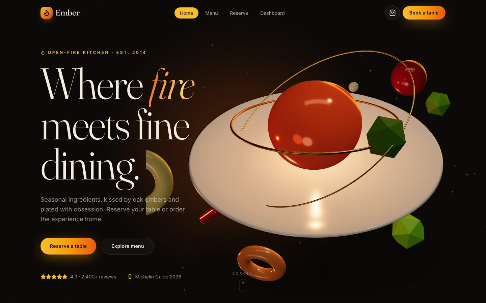
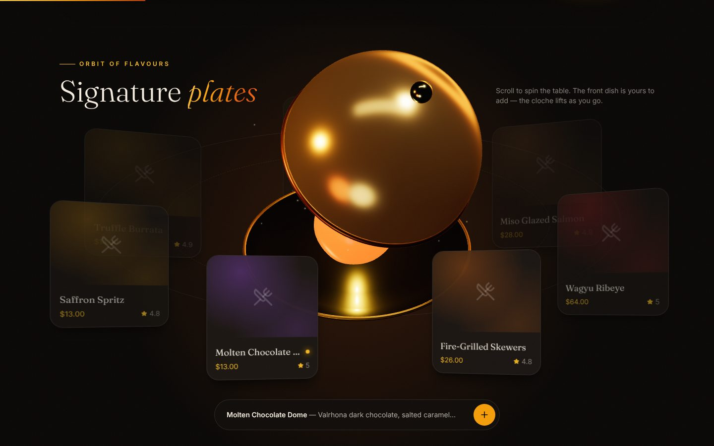
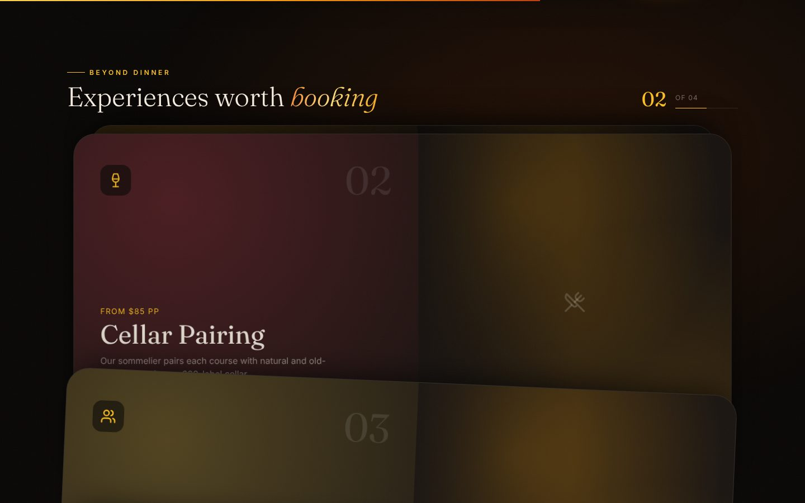
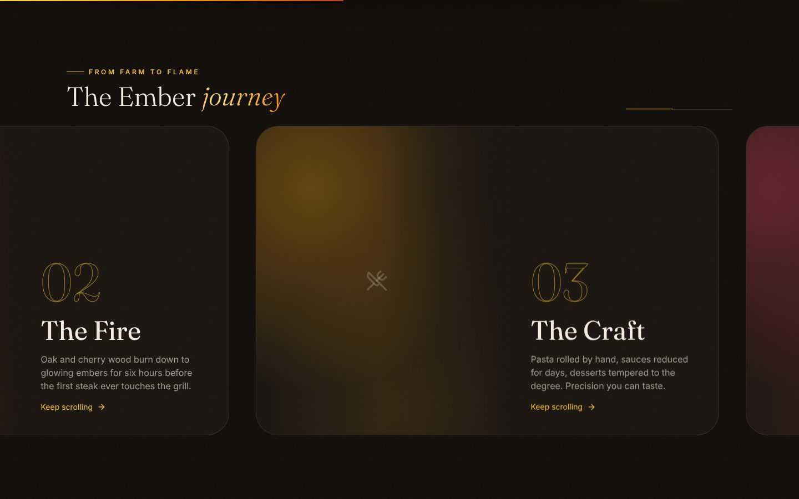
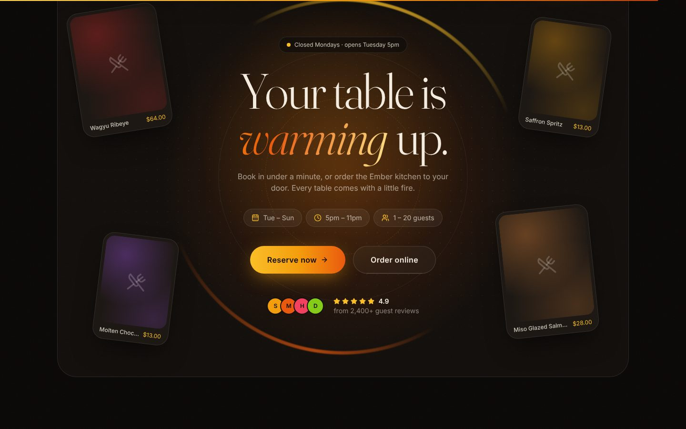
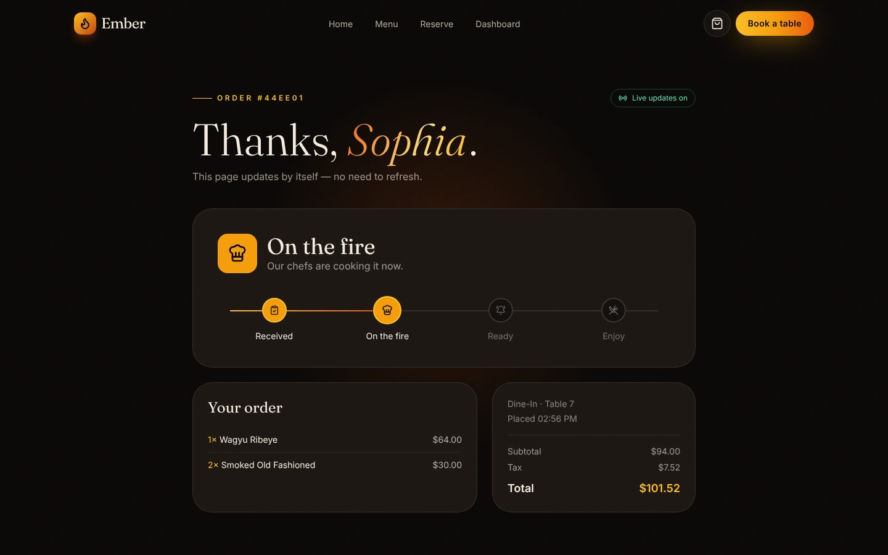
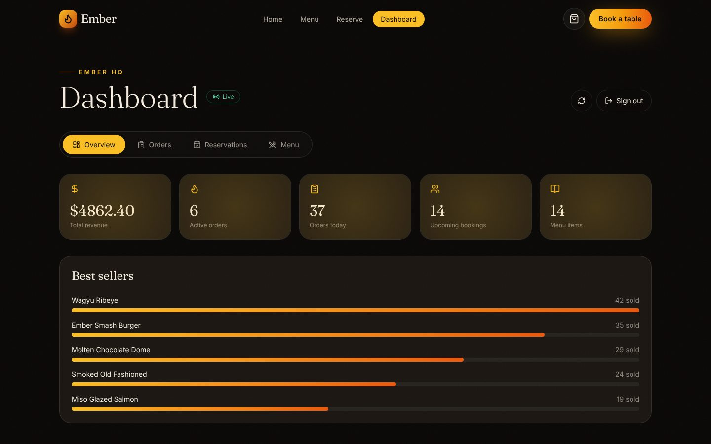
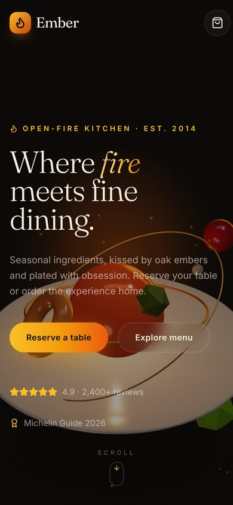

<div align="center">

# 🔥 Ember: Restaurant Management System

**A full-stack MERN restaurant platform with online ordering, table reservations, real-time order tracking and a staff dashboard, presented through an interactive 3D, scroll-driven frontend.**

[](https://github.com/sadiqqgavvi-gif/Restaurant-Management-System/actions/workflows/ci.yml)


**Live demo:** _add your Render URL here after deploying (see [Deploy](#-deploy-free))_



</div>

## ✨ Highlights

- **Real-time order tracking.** Customers get a live tracking page, and every status change from the kitchen appears instantly via Server-Sent Events. Staff see new orders arrive live on the dashboard.
- **Secure ordering.** The server recalculates every price and the tax from the database, so a tampered request can't change the total. The public tracking view never exposes phone, email or address.
- **Staff dashboard** with JWT auth: revenue and best-seller stats, order and reservation workflows, and menu management.
- **Interactive 3D and motion.** Built with React Three Fiber, GSAP ScrollTrigger and Lenis smooth scrolling, tuned for performance: off-screen WebGL pauses, DPR adapts on slow devices, and per-frame updates stick to compositor-friendly properties.
- **Tested.** Unit and API integration tests run in GitHub Actions on every push.

## 📸 Screenshots

| Orbital menu (pinned, scroll-driven) | Experiences card deck |
| --- | --- |
|  |  |
| **Horizontal scroll journey** | **Reservation call-to-action** |
|  |  |
| **Live order tracking** | **Staff dashboard** |
|  |  |

<p align="center"></p>

## 🧩 Features

**Customers**
- Menu with category filters, search, 3D tilt cards and a persistent cart
- Checkout for pickup, delivery or dine-in, followed by a live tracking page (`/track/:id`)
- Table reservations with party size, time slots, occasion and validation

**Staff (`/admin`)**
- Overview: revenue, active orders, today's orders, upcoming bookings, and an animated best-sellers chart
- Orders: live feed with new-order notifications; update status (pending → preparing → ready → served)
- Reservations: confirm, seat, complete or cancel
- Menu: add or delete dishes, toggle availability and "featured on the home orbit"

**Motion and 3D**
- Preloader with a curtain reveal, word-by-word masked headings, custom cursor and magnetic buttons
- 3D hero dish (lathe-modelled plate, distort-material centrepiece, orbiting ingredients) that follows the mouse and scroll
- Pinned orbit of dish cards around a 3D cloche whose lid lifts as you scroll
- Horizontal scroll section with velocity skew, a pinned card deck, opposite-direction marquees and parallax

## 🏗️ Architecture

```
client/  React 19 + Vite + Tailwind v4
  src/components/three/   R3F scenes (HeroScene, ClocheScene)
  src/components/ui/      Animated UI kit (SplitReveal, TiltCard, MagneticButton…)
  src/sections/           Home page sections
  src/pages/              Home, Menu, Checkout, TrackOrder, Reservations, Admin
server/  Express 5 + Mongoose
  src/app.js              Express app (importable by tests)
  src/lib/pricing.js      Server-side order pricing (pure, unit-tested)
  src/lib/events.js       Order event bus + Server-Sent Events helper
  src/models/             MenuItem, Order, Reservation, User
  src/controllers/        Route handlers
  test/                   node:test unit + supertest integration tests
```

**Real-time flow:** `PATCH /api/orders/:id/status` → `orderEvents.emit` → open SSE connections (`/api/orders/:id/stream` for the customer, `/api/orders/stream` for staff) → the UI updates without polling.

## 🚀 Run locally

```bash
npm run install:all
cp server/.env.example server/.env
npm run dev          # API on :5000, React on :5173
```

Leave `MONGO_URI` empty for a zero-setup **in-memory MongoDB**. The first run downloads the MongoDB binary once (700+ MB on Windows), and data resets on restart. For persistent data, set `MONGO_URI` to a MongoDB Atlas or local connection string.

Dev login for `/admin`: `admin@ember.com` / `admin123`.

```bash
npm test             # API unit + integration tests
```

## 🌍 Deploy (free)

The repo includes a `render.yaml` blueprint that runs one Node service serving both the API and the built React app.

1. **MongoDB Atlas.** Create a free M0 cluster, add a database user, and allow access from `0.0.0.0/0` under **Network Access**. Copy the connection string and add the database name: `…mongodb.net/ember?retryWrites=true&w=majority`
2. **Render.** Go to [render.com](https://render.com), choose **New → Blueprint**, and select this repository.
3. Fill in the two secret values when asked:
   - `MONGO_URI`: your Atlas string
   - `ADMIN_PASSWORD`: a strong password (`admin123` is refused in production)
4. Deploy. The menu and an admin user are seeded automatically on first start. Add the URL at the top of this README.

> The free Render plan sleeps after inactivity, so the first request can take ~30 seconds.

## 🔌 API

| Method | Endpoint | Access |
| --- | --- | --- |
| GET | `/api/menu?category=&featured=&q=` | public |
| POST · PUT · DELETE | `/api/menu[/:id]` | admin |
| POST | `/api/orders` | public (rate-limited) |
| GET | `/api/orders/:id` · `/api/orders/:id/stream` (SSE) | public tracking view |
| GET | `/api/orders` · `/api/orders/stream` (SSE) | staff |
| PATCH | `/api/orders/:id/status` | staff |
| POST | `/api/reservations` | public (rate-limited) |
| GET · PATCH | `/api/reservations[/:id/status]` | staff |
| POST · GET | `/api/auth/login` · `/api/auth/me` | public · staff |
| GET | `/api/stats` | staff |

## 🛠️ Troubleshooting

- **`/api/... 502/503` in the browser**: the API isn't running. Run `npm run dev` from the repo **root** and check the `[api]` lines in the terminal.
- **`THREE.Clock … deprecated` warning**: comes from inside React Three Fiber and is harmless.

## 📝 Notes

- Dish photos are hot-linked from Unsplash. Swap them for your own in `server/src/data/menu.json`.
- One known limitation: SSE events go through an in-process emitter, so for multiple server instances you'd swap it for Redis pub/sub or MongoDB change streams.
